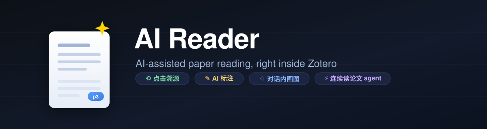
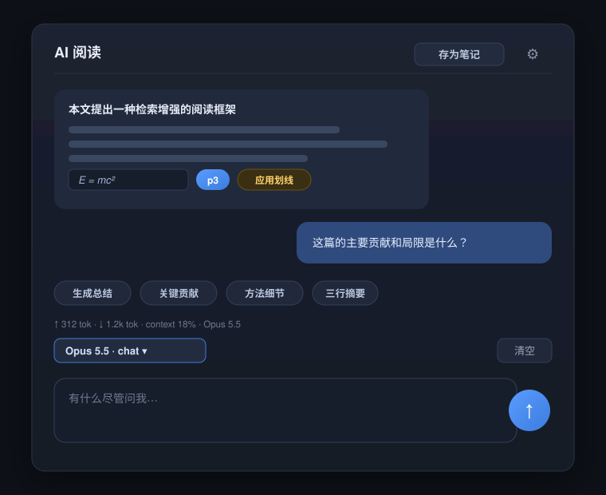

<div align="center">



<h1>AI Reader for Zotero</h1>

<p>Read papers with AI inside Zotero's item pane. Answers cite the source; click a page badge to jump back into the PDF.</p>

<p>
  
  
  
</p>

<b>English</b> · <a href="README.zh-CN.md">中文</a> · <a href="https://github.com/dongZheX/obsidian-ai-reader">Obsidian version</a>

</div>

---

## What it is

A chat panel in Zotero's item-pane sidebar. Select a paper and ask about it; the paper's text goes to the model as context, so answers come from the document rather than the model's memory.

Two things set it apart from a plain chat box:

- **Answers cite the page.** A claim can carry a page badge (`p7`). Click it to open the reader at that paragraph with a brief highlight. The mapping comes from Zotero's structured text (page + coordinates per block).
- **It writes annotations.** The model proposes "highlight this" / "note that" as buttons. Nothing changes your library until you click; then it writes a native highlight tagged `AI`, which you can remove from the panel.

<div align="center">

</div>

### Demo

<div align="center">

<video src="https://github.com/dongZheX/zotero-ai-reader/releases/download/v0.10.1/demo.mp4" controls muted width="720"></video>

<sub><a href="https://github.com/dongZheX/zotero-ai-reader/releases/download/v0.10.1/demo.mp4">▶ Watch the demo</a> if the player doesn't load.</sub>

</div>

## Features

| | |
|---|---|
| **Grounded chat** | Whole paper as context. Streaming Markdown (`marked` + KaTeX, incl. `$…$` / `$$…$$` math); token and context usage shown per message. |
| **Click-to-source** | `[B<id>]` citations render as page badges; click to jump and highlight the block in the reader. |
| **AI annotations** | The model proposes highlights/notes; apply them in one click as native annotations. `✕` removes every annotation it added at that spot. |
| **Read & annotate agent** | One click sends the agent through the whole paper, applying colour-coded highlights + notes by category (contribution / method / result / limitation / key term). De-duplicated, idempotent, with a progress log and one-click undo. |
| **Reading skills** | Pick a mode in the header — 精读理解 (default), 同行评审, 三遍速读, 领域综述, 可复现复刻, 批判红队, 导师讲解, 速览. Each swaps the quick-action chips and injects its method. |
| **Figure vision** | Render a figure or table region to an image for a multimodal model, instead of reading the caption text alone. |
| **Web search & fetch** | `web_search` (Google via Serper, needs a key) and `web_fetch` (read a page as text) for background beyond the paper. |
| **Scholarly discovery** | Trace a paper's **references**, find **related & follow-up** work, and look up any paper by title/DOI/arXiv — via the free Semantic Scholar graph. With a Serper key, keyword lookup upgrades to Google Scholar (with citation counts). |
| **Inline diagrams** | The model draws with a ` ```svg ` block, rendered inline (sanitized, scaled to the panel). Source is hidden while it streams. |
| **Continuous context** | The conversation is one running history — earlier reads stay visible, so the model doesn't re-read; it auto-compacts when long. |
| **Full-text translation** | Translate the whole document into your output language — segmented, translated concurrently with neighbour context so terms stay consistent, delivered as a bilingual child attachment you open in the reader (progress bar while it runs). |
| **Web snapshots & HTML** | Snapshots / HTML attachments (not just PDFs) can be summarized, chatted with, and translated — read from Zotero's `.zotero-ft-cache`. Citations on a snapshot jump via the reader's full-text search. |
| **Multi-paper compare** | Add papers to a compare basket and ask across them at once. |
| **Share materials** | Generate a one-page Markdown summary or a section-by-section illustrated HTML share page (embeds the paper's own figures, hand-drawn SVG, Q&A cards). The HTML page leads with an authoritative paper-info card (title, authors, venue·year, clickable arXiv/DOI, abstract — pulled from the Zotero item, not the model) and ships **4 switchable visual themes** (journal / modern / swiss / warm) with dark-mode support. |
| **Multi-machine chat sync** | Conversations persist into a Zotero-synced data note, so history follows you across machines. |
| **Selection popup** | Select text in the reader to quote it, explain it (streaming, with copy and "write to annotation"), or translate it. |
| **Your notes as context** | Reads your existing highlights and notes, so you can ask "summarize my highlights". |
| **Persistence** | History is saved per attachment and restored next time; save any conversation as a Zotero note. |
| **Provider-agnostic** | OpenAI `chat/completions`, OpenAI `responses`, Anthropic `messages`, and compatible gateways (DeepSeek, Moonshot, local Ollama / vLLM). |

## Install

1. Download `ai-reader.xpi` from [Releases](https://github.com/dongZheX/zotero-ai-reader/releases) or the repo.
2. Zotero: **Tools → Add-ons → gear → Install Add-on From File…**, pick the file.
3. Restart Zotero.

Works on Zotero 7 / 8 / 10 / 11. Click-to-source needs the structured text in Zotero 10+; on 7 and 8, chat and summaries work but precise recall does not.

## Configure

Open **Settings → AI Reader**:

| Field | Notes |
|---|---|
| API format | **Auto** picks by model name (Claude → `/messages`, OpenAI → `/responses`), or force one. |
| Base URL | A bare host gets `/v1` appended; `http` is upgraded to `https`. |
| API Key | Your key. |
| Model | e.g. `gpt-5`, `deepseek-chat`, `claude-opus-5-5`. |
| Output language | 中文 / English / 日本語. |
| Temperature | Sampling temperature. **Leave blank to use the model's default** — only sent when you enter a value (some models, e.g. GPT reasoning models, reject a custom temperature). |
| Max characters | Upper bound on injected body text. |
| Max output tokens | `0` = no limit. |
| Parallel tools | Read-only tool calls run up to this many at once; set `1` if your API rejects parallel requests. |
| Serper API Key | Enables `web_search` ([serper.dev](https://serper.dev)); optional. |
| Custom instructions | Extra guidance appended to the system prompt; optional. |

## Usage

1. Select a paper with a PDF attachment, or open it in the reader.
2. Expand the **AI Reading** section. Click **Generate summary** or type a question.
3. Click a `p<page>` badge to jump; click **Apply highlight / note** to create a real annotation.
4. In the reader, select text for **Ask in sidebar / Explain / Translate**.
5. Click **Save as note** to write a conversation into the item's Zotero note.

## How it works

```
Zotero.SDT.getReader(attachmentID).materialize()
      └─ text blocks with page + coordinates → [B<id> p<page>]
                 │  system prompt: cite with [B<id>], propose [[hl:id]] / [[note:id|text]]
                 ▼
         streaming reply → marked + KaTeX
                 ├─ [B<id>]      → page badge → Zotero.Reader.open()      jump + highlight
                 └─ [[hl|note]]  → button      → Zotero.Annotations.saveFromJSON()
```

Everything that shapes the model lives in the **system message**: paper context, a style guide that cuts AI-isms, the SVG drawing rules, the selected reading skill, and your custom instructions. The conversation then runs as one continuous history — user, assistant, and tool turns (read a section, view a figure) accumulate, so earlier reads stay visible and aren't repeated. When it grows long, the oldest rounds are summarized and the recent ones kept. On Anthropic the stable prefix uses `cache_control` for prompt-cache hits, and read-only tools run in parallel.

## Build

```bash
zip -r -q ai-reader.xpi manifest.json bootstrap.js prefs.js content locale
node test/sim.js        # → ALL OK
node test/snapshot.js   # → SNAPSHOT OK  (snapshot anchors + citation navigation)
```

## Limitations

- **PDF** click-to-source is precise (page + coordinates). **Snapshots / HTML / EPUB** have no page geometry, so citations jump by driving the reader's full-text search to the sentence instead — reliable for text, but it can't highlight figures/tables there.
- Long papers are truncated at "max characters"; raise it for large-context models.

## Development

The plugin ships an opt-in **dev bridge** (pref `extensions.zotero.aireader.devBridge`, default off) that gives a real REPL into a *running* Zotero — invaluable for anything touching the reader/DOM. Enable the pref, then:

```bash
node scripts/zdev.mjs 'return this.version'      # run code in the live plugin scope
node scripts/zdev.mjs -f snippet.js              # …or from a file
```

Code runs as an async body with `this` === the `AIReader` object (full access to the reader, blocks, DOM); you can even hot-redefine methods without reinstalling. It only reads one local file and runs in-process — no network. See `CLAUDE.md` for the full workflow. Keep the default **off** in released builds.

## Acknowledgements

| Project | Borrowed |
|---|---|
| [Moonlight](https://www.themoonlight.io/zh) | Integrated reading-assistant model |
| [yilewang/llm-for-zotero](https://github.com/yilewang/llm-for-zotero) | Sidebar panel layout |
| [papersgpt/papersgpt-for-zotero](https://github.com/papersgpt/papersgpt-for-zotero) | In-Zotero Q&A engineering |
| [cboulanger/zotero-skills](https://github.com/cboulanger/zotero-skills) | AI/Zotero interface ideas |
| [stark1tty/zotero-AI-Butler](https://github.com/stark1tty/zotero-AI-Butler-english) | Prompt templates, note formatting |
| [blader/humanizer](https://github.com/blader/humanizer) | The de-AI style guide |
| `artifact-design` skill | "Avoid AI-generated design" for the SVG rules |
| [bytedance/deer-flow](https://github.com/bytedance/deer-flow) | Peer-review and survey reading skills |
| [S. Keshav, *How to Read a Paper*](https://web.stanford.edu/class/ee384m/Handouts/HowtoReadPaper.pdf) | Three-pass reading skill |

## License

[Apache License 2.0](LICENSE)
